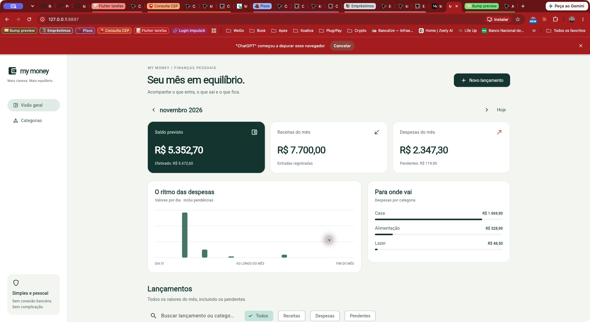

# My Money

[](https://flutter.dev)
[](https://dart.dev)
[](https://github.com/kleberandrade/my-money-fluter/actions/workflows/flutter.yml)

A local personal-finance application by **Kleber Andrade**, built with Flutter. Record income and expenses, organize categories and understand your month without connecting a bank account. The interface uses Brazilian Portuguese and BRL; documentation is in English.



## Run it

Verified toolchain: **Flutter 3.41.9**, bundled **Dart 3.11.5**, Chrome. Install that Flutter release, then:

```sh
flutter pub get
flutter run -d chrome --web-port 8897
```

The first launch is empty. Choose **Experimentar com exemplos** to load six fictional transactions and four categories into an entirely empty database. Demo data is optional, uses the selected month and never overwrites existing records. Alternatively, create a category and choose **Novo lançamento**.

For a release preview:

```sh
flutter build web --release --no-wasm-dry-run
python3 -m http.server 8897 --bind 127.0.0.1 --directory build/web
```

Open <http://127.0.0.1:8897>. Keep the same origin when testing persistence. This command serves locally; it does not deploy the application. WebAssembly is not a validated target.

## Features and controls

- Monthly income, expenses, projected balance and settled balance. **Saldo previsto** includes pending entries; **Efetivado** excludes them. **Pendentes** shows the unsigned total of pending income and expenses.
- Previous/next month arrows and **Hoje**. Aggregations compare both year and month, so November from different years cannot mix.
- Daily expense chart and category breakdown (four largest categories). Both include pending expenses; the daily chart has a screen-reader description with exact values.
- Search description/category and filter all, income, expense or pending entries. Select an entry to edit; its action menu also offers deletion with confirmation.
- Create/edit categories with a name, icon and color. Historical entries retain their saved category snapshot when a category is renamed or deleted.
- Validated transaction forms with date picker or keyboard entry. Use `1.234,56` for money and `dd/mm/yyyy` for dates. Empty, negative, zero, ambiguous decimal and impossible date inputs are rejected.
- Responsive desktop navigation and compact bottom navigation; scrollable forms, labeled controls, keyboard focus, larger-text support and loading/error/empty states.

No bank integration, credentials, cloud account, investment advice, currency conversion or synchronization is included. New monetary values are stored in integer cents; aggregates use arbitrary-precision integers so large ledgers remain exact on the Web too. Formatting is separate from persisted values.

## Storage and upgrade

Sembast **3.8.7** and sembast_web **2.4.4+1** are the compatible versions resolved on the verified toolchain; newer releases require newer Dart versions. `pubspec.lock` is committed for reproducible application installs.

Native builds retain `Documents/my_money.db`, original store names, keys and application IDs. On first upgrade, an atomic schema migration adds integer cents and date-only fields without deleting legacy fields. Invalid records abort the migration. **Back up the file before upgrading; do not downgrade a migrated database.** See [migration details and compatibility tests](docs/MIGRATION.md).

The browser uses IndexedDB scoped to its profile and origin. It does not share the native database. Browser site-data removal or uninstalling the native app can erase local data. This app does not offer export/restore or encrypted storage.

## Architecture

- `lib/domain/ledger.dart`: immutable category/entry models, exact money parsing/formatting, strict calendar dates and pure monthly aggregation. No Flutter dependency.
- `lib/data`: Sembast migration/repository; conditional native and Web database openers. CRUD uses persistent keys, never positions in a list.
- `lib/state`: a small observable ledger controller handles loading, mutations, retryable errors and the selected month.
- `lib/ui`: Material 3 screen, editors, summary/insights, category visuals and shared colors. Charts and visuals are Flutter-native; no downloaded artwork or paid fonts are required.

**Glossary:** entry = one income/expense record; cents = integer BRL minor units; pending = not yet paid/received; month = calendar year and month; category snapshot = historical embedded name/icon/color.

## Verify

```sh
dart format --output=none --set-exit-if-changed lib test
flutter analyze
flutter test --coverage
flutter test --platform chrome test/domain
flutter build web --release --no-wasm-dry-run
flutter build ios --release --no-codesign
flutter build apk --debug
```

Tests cover money/date boundaries, year-aware aggregation, pending balances, storage migration/rollback/reopen, persistent IDs, CRUD, demo protection, state errors and widget flows. The GitHub workflow pins Flutter 3.41.9 and runs formatting, analysis, tests (including domain tests in Chrome) and release Web compilation on pushes to `main` and pull requests. The badge reports the actual workflow status; no coverage percentage is claimed by the badge.

See [verification notes](docs/VALIDATION.md) for actual results, screenshot evidence and platform limits. `crapper`, `dryer` and `mutator` were invoked, but do not support Dart and reported no source files. No CRAP, duplication or mutation score is claimed.

## Native platforms

Android uses Gradle 8.14, AGP 8.11.1, Kotlin 2.2.20 and Java 17 bytecode with the Flutter SDK's platform versions (minimum SDK 24, compile/target SDK 36 on the verified release). Android application ID remains `com.example.my_money`. Accept Android SDK licenses yourself if needed; this task did not accept them. Debug signing in the generated release configuration is for local testing, not store distribution.

iOS targets **15.0+** for Xcode 27.2 compatibility, uses UIScene and retains `com.example.myMoney`. A successful unsigned build does not validate device installation; signing and an Apple team must be configured for distribution. No physical phone validation is claimed. macOS desktop is not a configured target.

## Credits, references and license

Original project: [kleberandrade/my-money-fluter](https://github.com/kleberandrade/my-money-fluter). Original learning resources remain useful: [Flutter codelab](https://docs.flutter.dev/get-started/codelab), [Flutter cookbook](https://docs.flutter.dev/cookbook), and [Flutter documentation](https://docs.flutter.dev). Storage APIs follow the [Sembast documentation](https://pub.dev/packages/sembast) and [Sembast Web documentation](https://pub.dev/packages/sembast_web).

No project-specific Medium article was linked in the original README or tracked sources; none was identified in the targeted public search. No article was associated by title similarity or edited. No standalone repository-wide license existed in the original revision or GitHub metadata. This modernization does not invent a license, relicense existing code, or remove author/third-party credits. Flutter, packages and generated platform assets retain their respective upstream licenses.
