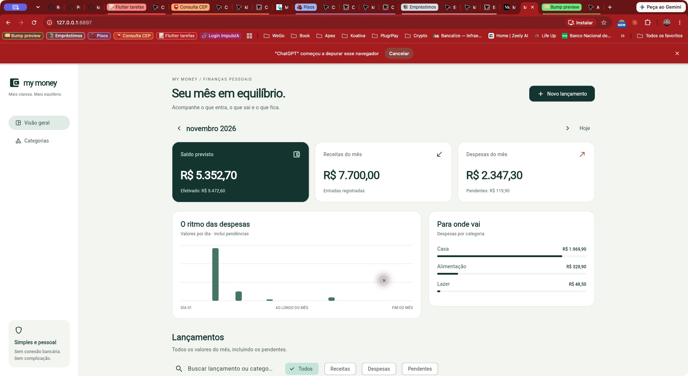
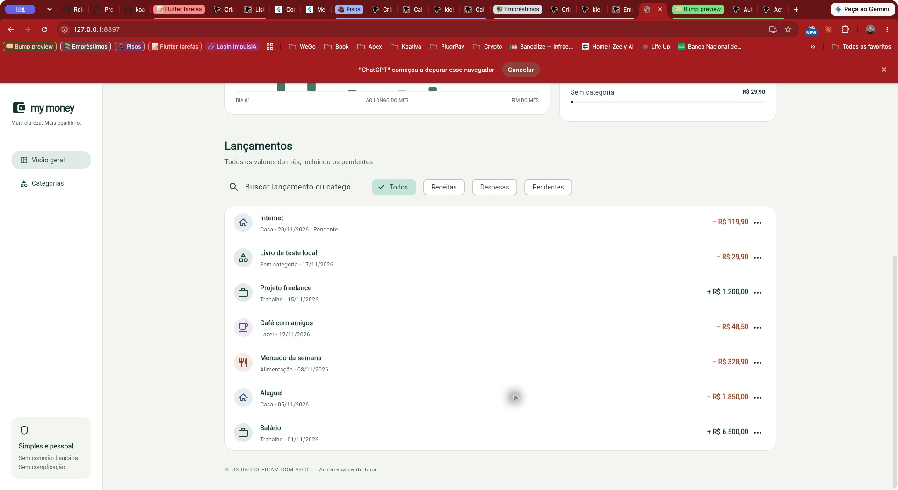
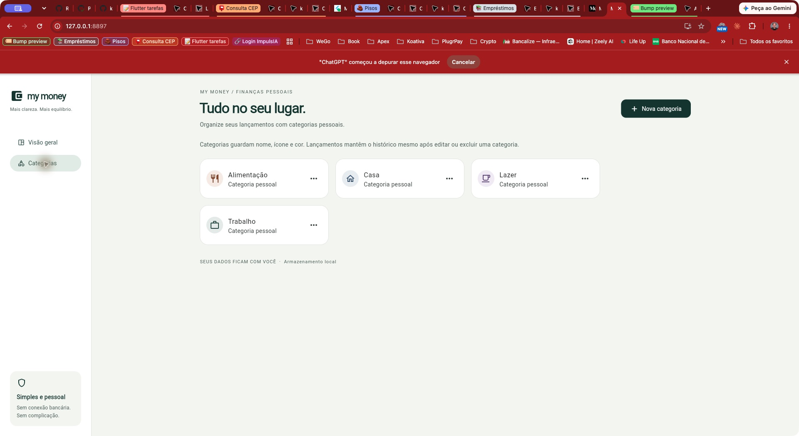
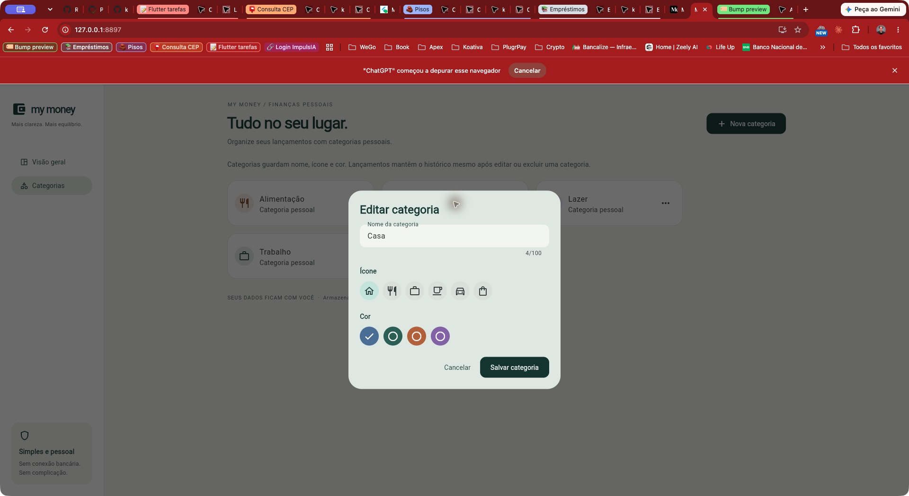
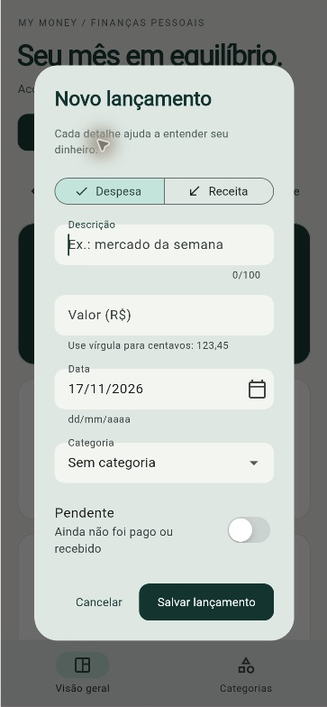

# Verification — 2026-11-17

Environment: Flutter 3.41.9 stable / Dart 3.11.5 on macOS 27.2.1 arm64, Chrome 157, Xcode 27.2, Android SDK 36.1 with JDK 21. Flutter's Android defaults resolve min SDK 24, compile/target SDK 36; Java/Kotlin bytecode targets 17. No shared SDK was updated.

## Automated results

- `flutter test --coverage`: **14 tests passed**, including exact cents and invalid input, leap dates and calendar years, pending versus settled totals, Sembast migration rollback/reopening, native-file persistence, CRUD with deleted-key gaps, demo protection, controller error/retry and three widget flows. Aggregates use arbitrary-precision BigInt to remain exact beyond the browser’s 53-bit safe-integer range; a 10,001-entry maximum-value fixture verifies this.
- `flutter test --platform chrome test/domain`: **4 tests passed in headless Chrome**, including the large-ledger exactness boundary.
- `flutter analyze`: **No issues found**.
- `dart format --output=none --set-exit-if-changed lib test`: checked before publishing.
- `flutter build web --release --no-wasm-dry-run`: successful JavaScript release build. The initial optional WASM dry run was interrupted; WASM is not validated. A warning about unused Cupertino font defaults remains; Material icons were inspected in the finished app.
- `flutter build apk --debug`: successful debug APK; no installation/emulator/physical-device execution tested. Doctor reports some other Android licenses missing; none accepted by this task.
- `flutter build ios --release --no-codesign`: successful unsigned arm64 Runner.app. The initial template's iOS 13 deployment target failed on Xcode 27.2; iOS 15 is now configured, including CocoaPods targets. No signing or iPhone execution tested.

Coverage is generated locally in ignored `coverage/lcov.info`; it includes repository, pure domain, state and exercised widgets. The native platform opener is exercised by builds rather than unit mocks; browser persistence is exercised manually below. No percentage threshold, passing badge or mutation score is fabricated. `crapper lib`, `dryer --threshold 0.8 lib`, and `mutator --scan lib` each returned “No source files…” because the installed tools do not support Dart.

## Real browser interaction

Served the release build with `python3 -m http.server 8897 --bind 127.0.0.1 --directory build/web` and opened the real app in its own Chrome tab at <http://127.0.0.1:8897>. This is a local preview, not a deployment.

1. Started empty, loaded the six fictional demo entries explicitly. Projected balance 5,352.70 BRL; settled 5,472.60 BRL.
2. Submitted an empty transaction form and observed required-description and invalid-money errors.
3. Added “Livro de teste local”, 29.90 BRL, 17/11/2026. Projected balance became 5,322.80 BRL; settled 5,442.70 BRL. The daily chart/category breakdown updated.
4. Reloaded Chrome and confirmed the entry and totals survived in IndexedDB.
5. Opened categories and the existing category editor; inspected icon/color controls.
6. Used Chrome's responsive toolbar at **390×844 CSS pixels**, inspected bottom navigation and the scrollable transaction form. Restored desktop view afterward. This is browser emulation, not a phone test.
7. Widget tests separately exercise search, save, invalid input, category create/edit/delete/cancel and 390×844 at 1.4× text scale with maximum money. The stronger case exposed and then verified fixes to narrow entry/chart layouts.

## Screenshot evidence

These are screenshots of the running Flutter release app, with only surrounding browser/tool chrome cropped out. No mockups, generated images or fabricated device frames.

The first desktop capture has the unmodified six demo entries; the mobile capture includes the extra fictional expense from the manual save/persistence check. Screenshots are at the browser's fitted display scale.

## Publishing and references

GitHub About was updated in English and verified. Topics: `dart`, `flutter`, `local-storage`, `mobile-development`, `personal-finance`, `dart3`, `flutter-web`, `money-management`, `offline-first`, `sembast`. Original five preserved.

No own Medium tutorial was linked in the original README (including revision 1d20823) or source. Targeted public searches did not identify a project-associated article. No Medium article was edited, invented or associated solely by similarity. The unrelated original Flutter codelab/cookbook references are preserved.

CI result is recorded by the live [Flutter workflow](https://github.com/kleberandrade/my-money-fluter/actions/workflows/flutter.yml); publication details are in the action log and completion report.
